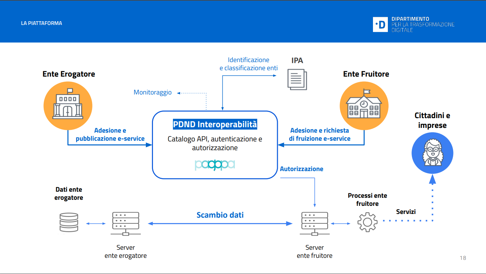

# G3W-ADMIN-PDND

[](https://pypi.org/project/g3w-admin-pdnd/)
[](https://deepwiki.com/g3w-suite/g3w-admin-pdnd) [](https://github.com/g3w-suite/g3w-admin-pdnd/actions/workflows/ci.yml)

A [G3W-SUITE](https://github.com/g3w-suite) plugin for [**Piattaforma Digitale Nazionale Dati**](https://innovazione.gov.it/progetti/dati-e-interoperabilita/) (PDND).



### Auhtentication
The plugin support the first level of authentication required by **PDND** based con `voucher token` analisys.

The second level of authentication base on `Agid-JWT-TrackingEvidence` http header is no supported.

*The Agid-JWT-TrackingEvidence header has been introduced in the AUDIT_REST_XX patterns with the update of the Technical Interoperability Guidelines of May 23, 2023*

## Installation

Install *qpdnd* module into [`g3w-admin`](https://github.com/g3w-suite/g3w-admin/tree/v.3.6.x/g3w-admin) applications folder:

(Change the following 1.0.0 example version number)
```sh
# Install module from github (v1.0.0)
pip3 install git+https://github.com/g3w-suite/g3w-admin-pdnd.git@v1.0.0

# Install module from github (dev branch)
# pip3 install git+https://github.com/g3w-suite/g3w-admin-pdnd.git@dev

# Install module from local folder (git development)
# pip3 install -e /g3w-admin/plugins/qpdnd

# Install module from PyPi (not yet available)
# pip3 install g3w-admin-pdnd
```

### Load lincense fixture data
```sh
python3 manaage.py loaddata license
```

## Development and tests

The integration BDD scenarios are in [`qpdnd/tests/features`](qpdnd/tests/features).
They run in the G3W-ADMIN/QGIS environment used by CI. Install test dependencies:

```sh
python3 -m pip install -r requirements_test.txt
```

From the configured G3W-ADMIN directory, run:

```sh
python3 manage.py behave --simple qpdnd/tests
```

The existing Django unit tests can be run with:

```sh
python3 manage.py test qpdnd
```
